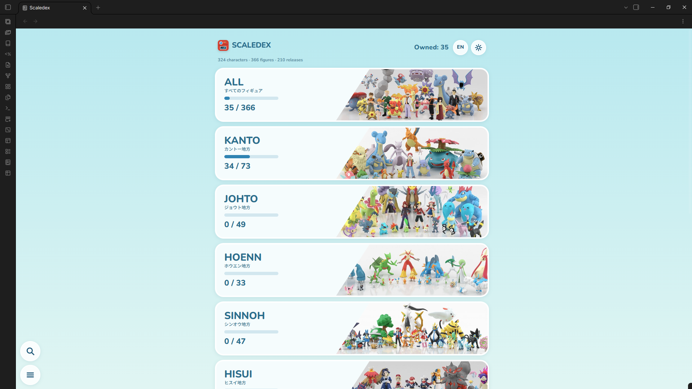
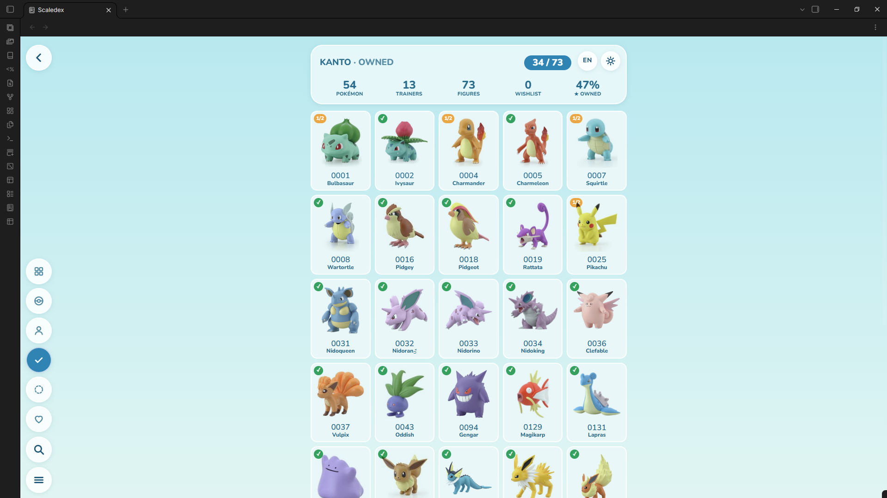
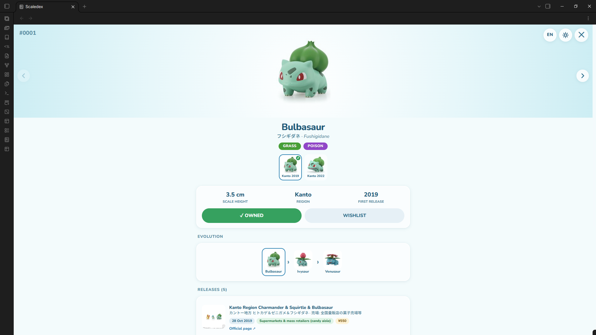
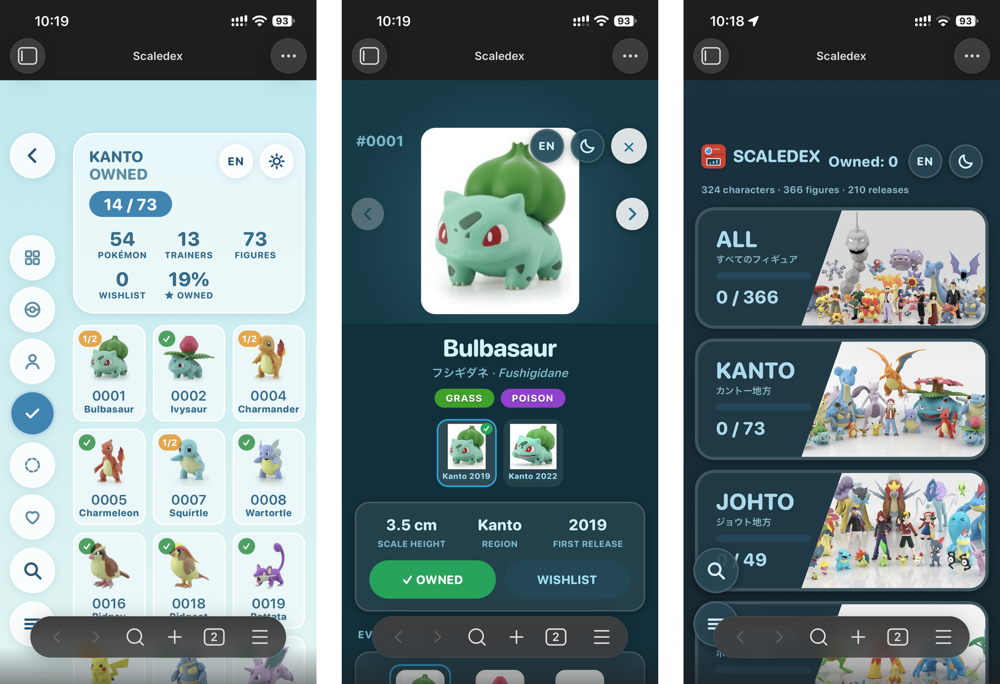

# Scaledex

A Pokédex for Bandai's **Pokémon Scale World** 1/20 figures: every figure, every release with its date and price, and your own owned / wishlist collection. Works on desktop, iPhone and Android.

Pokémon Scale World has hundreds of figures spread over candy-aisle waves, Premium Bandai sets, re-orders and re-sales. The official dex is Japanese only, runs months behind new announcements, and doesn't say what a figure cost or when it was re-released. Scaledex puts all of that in one place, styled after the Pokémon GO Pokédex.

## Browse by region

One card per Scale World line (Kanto, Johto, … Paldea) shows how much of it you own. **All** lists every figure, and **Upcoming** lists figures in sets that haven't shipped yet.

## Every figure and every release

A Pokémon's page shows its types, its evolution line with Megas, every figure version and every release of that figure: date, sales channel (candy aisle or Premium Bandai) and price in JPY. English and Japanese names (with romaji) and the figure's scale height are included. Trainers get their own pages with their role in the games (Gym Leader · Rock, Champion, Rival, …).

## Find any figure

Search by English, Japanese or romaji name, dex number, type ("fire"), Legendary / Mythical / Powerhouse, or trainer role ("gym leader"). Searching a Pokémon also finds its evolution line. Filter by Pokémon / Trainers / Owned / Missing / Wishlist and sort by dex number, name or release year.

## On your phone

The plugin works the same on iOS and Android, in light and dark themes. If your vault syncs, your collection comes with it.

## Usage

- Open Scaledex from the ribbon (dex icon) or the command palette: **Open Scaledex**.
- On a figure's page, tap **Owned** or **Wishlist** (or press `O` / `W`). Your collection is saved in the plugin's `data.json` in your vault, so it syncs and backs up with the vault.
- Press `/` or `Ctrl+K` (`⌘K` on Mac) to search, `Esc` to close.
- **Offline images:** run **Download images (offline use)** from the command palette, or use the button in the plugin settings.

### Settings

| Setting | What it does |
|---|---|
| Image source | Where online images load from. Default: the Scaledex web app's site. Leave empty to use Bandai's website (new sets then have no per-figure crops). |
| Download images | Saves every figure and product image (about 50 MB) into the plugin's own folder, `.obsidian/plugins/scaledex/cache/images/`, so the dex works offline. Nothing is written to your notes. |

## Disclosures

- **Network use:** the figure data ships inside the plugin. The only network requests are for figure images, from `huyla1903.github.io` (the Scaledex web app), with Bandai's image servers as fallback.
- **Files:** the optional image download stores about 50 MB in the plugin's folder. The plugin doesn't read or change your notes.
- **Privacy:** nothing about you or your collection is sent anywhere. No account, no ads, no telemetry.
- **Open source:** MIT licensed; the source is in this repository.

## Web app

Don't use Obsidian? Open **https://huyla1903.github.io/Scaledex/** in any browser. On iPhone, tap Share → **Add to Home Screen** to use it like an app; it works offline once loaded.

- Your collection is saved in the browser's local storage. Back it up with menu → **Export / Import collection**.
- Menu → **Save all images for offline** stores the images in the browser's offline cache for the site.
- Links can open straight to a view: `?region=kanto`, `?region=upcoming`, `?open=p0025` (Pikachu), `?open=t-red` or `?q=charmander`.

## Data sources

- **Figures, images, scale heights:** the official dex at bandai.co.jp/candy/pokemonscaleworld/lineup/.
- **New and upcoming sets the official dex doesn't list yet:** the Bandai Candy Scale World brand page, with Bandai's product photos until the official dex adds the figures.
- **Candy-aisle releases** (price per box, date, where sold): Bandai Candy product pages.
- **Premium Bandai** (price, ship date): Internet Archive snapshots of p-bandai.jp, which blocks visitors outside Japan. Each release links to the snapshot it used.
- **Re-releases the official dex doesn't link, trainer order:** Bulbapedia's Pokémon Scale World article.
- **English names, types, evolution lines, Legendary / Mythical:** PokeAPI. Powerhouse follows Bulbapedia's "Powerhouse Pokémon" list. Trainer names, roles and product-name translations are mapped by hand.

Prices are Japanese retail prices including tax; candy-aisle prices are per box.

Scaledex is an unofficial fan project, not affiliated with Bandai, Nintendo, Game Freak or The Pokémon Company. Figure and product images © Bandai / Pokémon.

## Installation

- **Community plugins:** Settings → Community plugins → Browse, search for **Scaledex**, install and enable it.
- **Manual:** download `main.js`, `manifest.json` and `styles.css` from the [latest release](https://github.com/huyla1903/Scaledex/releases/latest) into `<your vault>/.obsidian/plugins/scaledex/`, then enable **Scaledex** under Settings → Community plugins.

## Contributing

Bug reports and ideas are welcome in [Issues](https://github.com/huyla1903/Scaledex/issues). To build the data, the web app or the plugin yourself, see [CONTRIBUTING.md](CONTRIBUTING.md).

## License

[MIT](LICENSE)
